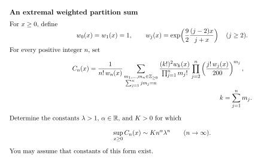

# Paper Math Bench

A Codex skill for turning mathematical research into hard, concise calculation problems with verified reference solutions and reproducible model evaluation.

**Contents**

- [What the skill does](#what-the-skill-does)
- [Install and invoke](#install-and-invoke)
- [Usage](#usage)
- [How a problem reaches final testing](#how-a-problem-reaches-final-testing)
- [Example](#example)
- [Evaluation defaults and limits](#evaluation-defaults-and-limits)
- [Package guide](#package-guide)

## What the skill does

| Entry point | Purpose | Output |
| --- | --- | --- |
| **Find** | Read papers and identify substantive calculation opportunities. | Checked source notes, candidate targets, dependencies, and remaining gaps. |
| **Author** | Construct difficult calculations from supplied or discovered literature. | Concise English problems, complete verified solutions, citations, and screening records. |
| **Elaborate** | Strengthen selected problems in an existing local TeX bank. | Revised problems and matching reference solutions within the authorized editing scope. |
| **Evaluate** | Test a local bank with fresh independent solver processes. | Version-bound submissions, grading, token accounting, and reports; the source bank stays read-only. |

The skill favors mathematical depth over long statements or obscure notation. Problem-specific definitions and answer-affecting conventions must be clear. Standard concepts are used by name, and formulas carry the statement wherever they improve clarity.

This English edition asks every intake and clarification question, including suggested options, in **English**, regardless of the conversation language. Original user replies are preserved verbatim in research and configuration evidence.

## Install and invoke

Clone this repository and copy its skill folder into the working project's `.agents/skills` directory. Replace `/path/to/project` with your project directory:

```sh
git clone https://github.com/BrookWW/SkillofCreatingCalculationProblems.git
mkdir -p /path/to/project/.agents/skills
cp -R SkillofCreatingCalculationProblems/paper-math-bench \
  /path/to/project/.agents/skills/paper-math-bench
```

Keep the complete `paper-math-bench` folder together: its scripts, references, and templates are part of the skill. Codex discovers project skills in `.agents/skills`; see the [official skills documentation](https://developers.openai.com/codex/skills#where-to-save-skills).

In Codex CLI or the IDE extension, invoke it in a prompt with:

```text
$paper-math-bench
```

Use a compatible Codex environment with Python 3.10 or later. Authoring also needs access to the selected literature and a TeX toolchain for compiling the final bank. Real model evaluation requires a Codex CLI that supports the exact requested model and settings.

## Usage

Give the skill the intended task and the paths it should use. It asks in English for required information that is still missing.

**Discover papers and author problems:**

```text
Use $paper-math-bench.

Find 10 arXiv papers first submitted between 2026-01-01 and 2026-04-01
in math.FA, math.AP, math.CA, math.DG, or math.CO.
Work continuously for 6 hours on research, construction, verification, and screening.
Append selected problems and complete solutions to /absolute/path/to/bank/main.tex.
Keep downloads, calculations, backups, and evaluation records in /absolute/path/to/cache.
Use the default gpt-5.6-sol / max screening configuration.
```

Paper discovery requires a date interval, principal-paper count, and subject scope. Full authoring has a separate work goal: a continuous duration or a requested number of accepted local T4 problems. A duration does not guarantee that any candidate will qualify.

**Evaluate an existing bank:**

```text
Use $paper-math-bench to evaluate all problems in /absolute/path/to/bank/main.tex.
Keep the source unchanged and put the evaluation bundle, runs, and reports
under /absolute/path/to/cache. Use the default model and budget.
```

To refine existing problems, identify the bank and selected labels, specify whether to append or replace them, and state whether formal model trials are in scope. The [task settings](paper-math-bench/references/execution/task-settings.md) describe the inputs for each entry point.

## How a problem reaches final testing

1. Research the mathematics and complete a verified reference solution.
2. Freeze the original statement, answer requirements, reference, and rubric.
3. Automatically start a fresh statement-reader agent with only the anonymous statement and public answer interface.
4. Make necessary editorial corrections, then use a separate semantic checker to compare the original and final tasks. Revisions must preserve objects, domains, quantifiers, assumptions, conventions, calculation targets, and answer requirements, without adding solution hints.
5. Recheck the final anonymous statement and validate its version-bound review record before the formal solver starts.
6. Preserve the raw trial and assess it against the verified reference. Grading and classification recheck the frozen review evidence.

A revision with uncertain or changed mathematical meaning cannot pass as an editorial clarification. Hashes bind the reviewed and tested versions; mathematical equivalence remains an independent mathematical judgment. See [statement review](paper-math-bench/references/research/statement-review.md) and [role prompts](paper-math-bench/references/execution/agent-prompts.md).

## Example

**An extremal weighted partition sum.** Determine the complete leading asymptotics of a weighted partition sum after taking the supremum over a real parameter.



The statement is typeset as a compiled vector image with embedded glyph outlines, so its formulas display without a local TeX installation.

## Evaluation defaults and limits

| Setting | Default |
| --- | --- |
| Screening model | `gpt-5.6-sol` |
| Reasoning effort | `max` |
| Formal attempts | One fresh independent attempt per final verified version |
| Requested per-attempt budget | 1,000,000 cumulative input plus output tokens |
| Budget reminder | At 660,000 tokens; unfinished work may continue within the requested total |
| Additional wall timeout | None |

The authoring and review agents inherit the current authoring configuration; selecting a screening model does not change them. Explicit user overrides take precedence. Unsupported runtime settings stop without silently substituting another model.

The CLI runner provides instruction-only isolation. It requests no source lookup or web use, but does not enforce a filesystem read allowlist or prove network isolation. Reported token accounting and requested native budget units may differ. T2/T3/T4 are local operational classifications, separate from official human-difficulty certification. Detailed rules are in [model testing and grading](paper-math-bench/references/evaluation/model-testing.md).

## Package guide

- [Skill entry point](paper-math-bench/SKILL.md)
- [Workflow and data flow](paper-math-bench/references/workflow-map.md)
- [Problem design](paper-math-bench/references/research/problem-design.md) and [refinement](paper-math-bench/references/research/problem-refinement.md)
- [Statement style](paper-math-bench/references/research/statement-style.md) and [independent statement review](paper-math-bench/references/research/statement-review.md)
- [Task intake and English question templates](paper-math-bench/references/execution/task-settings.md)
- [Development and validation](DEVELOPMENT.md)

The repository contains the reusable English skill, blank manuscript templates, synthetic implementation tests, and the single illustrated example above. Research problem banks, source PDFs, private solutions, model runs, and task caches stay outside the distribution.
