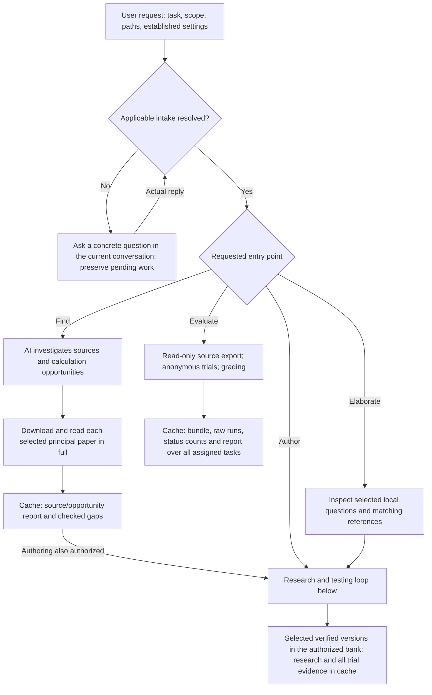
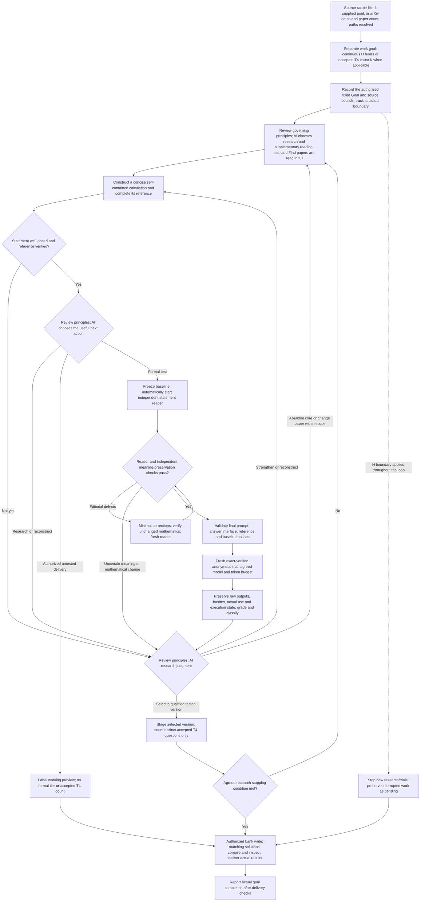

# Workflow and data flow

**Contents**

- [Entry points and outputs](#entry-points-and-outputs)
- [Research and testing loop](#research-and-testing-loop)
- [Inputs and retained artifacts](#inputs-and-retained-artifacts)

This map explains the workflow. The linked guides define its rules; the map does not add research thresholds or authorize execution by itself.

## Entry points and outputs

[Task intake](execution/task-settings.md#startup-intake) determines which inputs are needed for each entry point. New source discovery uses arXiv and requires a date interval and principal-paper count before either work-goal mode starts. Missing input pauses only dependent work. Find alone produces an opportunity report. Evaluation does not acquire editing authority or an authoring goal. Standalone elaboration follows its same-bank write scope and includes target-model trials only when they are authorized.

## Research and testing loop

The benchmark target is defined in the [main skill](../SKILL.md): the agreed `gpt-5.6-sol / max` trial fails to complete the task correctly within 1,000,000 cumulative input plus output tokens. [Formal testing](evaluation/model-testing.md#screen-authoring-candidates) defines the local groups and accounting limits. A whole-task duration interruption or execution error is pending; it is not evidence of token exhaustion or mathematical failure.

Before each research judgment, revisit the [governing principles](../SKILL.md). The AI chooses supplementary reading, synthesis, investigation, reconstruction, abandonment, paper replacement, and final selection under [research decisions](research/problem-refinement.md#post-trial-research-decisions). Selected Find papers must be downloaded and read in full under [principal-paper reading](research/paper-search.md#inspect-the-principal-mathematics). Trial classification never automatically admits a question. Useful mathematical work can continue after a T4 result; a cheap correct result can motivate reconstruction or replacement. A changed mathematical version needs a verified matching reference and a fresh formal test before final selection. Preserve completed trials rather than resampling an unchanged question until a failure appears.

The [continuous-goal guide](execution/continuous-goals.md) controls the whole task. H measures actual continuous elapsed work and can yield zero selected T4 questions. For K, reaching the selected-question quota ends research; overall completion follows only after delivery checks. Distinct questions may share a mathematical core, but equivalent rephrasings, parameter substitutions, versions, and retries do not multiply the count. A branch being abandoned does not complete either goal. The Goal interface does not natively enforce H or K; track them explicitly. Bounded untested previews and bounded standalone elaboration retain their agreed stopping conditions without an extra goal questionnaire; they cannot satisfy a T4 count without formal screening.

## Inputs and retained artifacts

| Stage | Input | Output and destination |
| --- | --- | --- |
| Intake | Actual user request, established choices, source/task scope, paths, applicable goal and test settings | Resolved choices and execution state in the task cache; focused questions for necessary gaps |
| Research | Supplied or discovered literature, existing questions, calculations and solve evidence | Source exposure, checked connections, meaningful versions, verified references and unresolved gaps in the cache |
| Statement review | Anonymous final prompt and answer interface for the reader; frozen original and matching private reference for a separate semantic checker | Independent findings and accepted exact-version bindings in the cache under [statement review](research/statement-review.md); no private review material goes to the solver |
| Formal solver | Only the exact anonymous statement and answer interface, with the agreed tools and limits | Raw submission, events, actual accounting and execution metadata in the cache; private solutions and research notes are not solver inputs |
| Grading and selection | Frozen task/reference/submission bindings, actual mathematical review and trial evidence | Preserved classification and pending states in the cache; AI selection of final versions, with distinct-question counting where applicable |
| Delivery | Selected versions, matching solutions and sources, authorized write scope | Final bank or explicitly labelled preview; all trial records, unselected versions, backups and reports remain in the cache |

Use the [path and write contract](execution/task-settings.md#paths-and-write-scope) and [manuscript checks](research/problem-design.md#present-and-write). A goal does not authorize replacing old questions. Evaluation-only output stays in the cache and retains the original assigned-task denominator.
